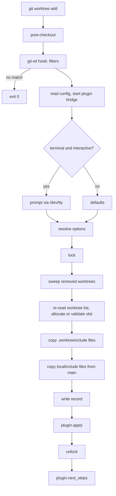

# Architecture

## Flow

`git wt add` sets `WT_*` variables and calls `git worktree add`, so it takes the same path. `git wt refresh` calls the same engine in `refresh` mode.

## Hook filters

The hook is registered globally, so `git-wt hook` runs on every checkout of every repository. It exits early, in this order:

1. The previous HEAD is not all zeros, so this is not a fresh checkout.
2. The checkout is not a branch checkout.
3. `--git-dir` equals `--git-common-dir`, so this is not a linked worktree.
4. The worktree path matches an `ignorePaths` pattern.
5. Neither `worktree-init.plugin` nor `worktree-init.localInclude` is set, and the main worktree has no `.worktreeinclude`.

Git runs the registered command through `/bin/sh -c`, because the command contains shell metacharacters. The command checks that the binary exists and then starts it. An ordinary checkout of a branch or file therefore costs one shell start, one binary start and no Git call, because the first two filters only read the arguments. The binary alone starts in about 3.6 ms. Two checkouts take about 32 ms without a hook, about 40 ms with the `hook.sh` of version 0.1 and about 51 ms with the binary behind the check. That is about 5 ms more per checkout than in version 0.1. Git aborts a checkout or push when a hook cannot run. Without the check, a missing or moved binary would fail every checkout and push on the machine. The project accepts the extra shell start for that reason. Issue [#2](https://github.com/V1ncNet/git-worktree-init/issues/2) tracks whether the shell can go away. A fresh branch checkout, such as the one at the end of a clone, adds one `git rev-parse` and one `git worktree list`. Only a new linked worktree adds another `rev-parse` and one `git config`. Python starts only for a plugin, after all filters passed.

## Python bridge

A plugin is Python. Rust cannot load it in-process. `git-wt` therefore starts the configured interpreter once per command and talks to it in JSON lines. The process stays for the whole run, because a function in `choices` gets the `Context` and runs during the prompt. The interpreter comes from `WT_PYTHON`, then `worktree-init.python`, then `python3`. The Nix package replaces `python3` with the Python of its nixpkgs input at build time.

The protocol runs over fds 3 and 4, not stdin and stdout. A plugin's `print()` and the output of `ctx.run` children therefore keep the inherited stdout and stderr. Rust opens every descriptor with `CLOEXEC`, so the binary places the two pipe ends on 3 and 4 in `pre_exec`. The bridge marks them non-inheritable again, so a child of the plugin cannot hold the pipes open.

The bridge sources are embedded in the binary and reach the interpreter in `argv` as JSON. A short boot script passed with `-c` turns them into the modules of `git_worktree_init`. The boot script writes no file, so no cache can go stale. With `-c`, the working directory is the first entry of `sys.path`. The hook runs inside the caller's repository, where a file could shadow a module of the standard library. The boot script removes that entry before its first import. The interpreter runs without `-I`, because `-I` would also drop `PYTHONPATH` and the user site-packages. A plugin may import a package installed there.

The boot script checks the Python version before it loads the bridge modules. If the version is too old, it fails with a message that names `worktree-init.python`. `git-wt` keeps lock, slots, records, options and prompts. The bridge keeps only `Context` and the plugin calls.

## Lock and slot allocation

Two worktrees created at the same time could otherwise pick the same free slot. Choosing a slot and writing it through the plugin therefore happen under one exclusive `flock` on `<common dir>/worktree-init.lock`. The worktree list is read again after the lock is taken, because the list read before the prompt may be stale. The prompt itself runs outside the lock, so a waiting user does not block others. Its recommended slot is only a default and is validated again under the lock.

## Source is the main worktree

`post-checkout` runs inside the new worktree. Nothing tells the hook which worktree `git worktree add` was called from, so the default source is the main worktree. `--source .` or `WT_SOURCE=$PWD` overrides this. The path must be absolute, because it is resolved inside the hook and not relative to the caller.

## Local includes ignore the source

`worktree-init.localInclude` names private files such as personal agent instructions. They are copied once and then diverge on purpose, so the copy in another worktree is not a reliable origin. The main worktree is, so these files always come from there, and an existing file is never overwritten. The list lives in the local config because naming these files in a tracked `.worktreeinclude` would publish them.

## `git -c` switches prompts off

`git -c worktree-init.slot=3 worktree add` reaches the hook as `GIT_CONFIG_PARAMETERS`. The engine reads config with `--show-scope`, sees the scope `command` and treats the option as given explicitly. Asking for an option that was just set on the command line would be wrong, so an option set this way, or through `WT_<NAME>`, disables the prompts.

## Sanitized Git environment

`GIT_DIR`, `GIT_WORK_TREE`, `GIT_INDEX_FILE` and `GIT_PREFIX` are removed for every Git call and every plugin subprocess. Git exports them to hooks, and they would pin each nested command to the repository and index of the caller instead of the directory it runs in. A plugin can name more variables in `SANITIZE_ENV`.

## Messages go to stderr

Git redirects the stdout of a hook to stderr. The core writes everything to stderr from the start, so output looks the same in the hook and in `git wt`. Only `-h` of `git wt` writes to stdout, because it is output rather than a message.

## `/dev/tty` with two handles

The prompt reads and writes the terminal, not stdin and stdout, which Git may have redirected. `/dev/tty` is opened twice, once for reading and once for writing. Two handles keep reading and writing independent of each other.

## Records and sweep

Git offers no event for removing a worktree. No hook runs for `git worktree remove`, `git worktree prune`, the worktree pruning in `git gc` or a deleted directory, not even `reference-transaction`. Several tools create and remove worktrees, so no wrapper can catch every removal. The tool instead remembers what it prepared and later checks what is gone.

A record is a JSON file `<git-common-dir>/worktree-init/records/<key>.json` with the slot, the target path, the admin directory name and the resolved options. The tool also writes the random key to a token file `worktree-init-record` in the admin directory `<git-common-dir>/worktrees/<name>`. The record itself cannot live there, because removing the worktree deletes the admin directory.

A record is alive while the admin directory holds its token and Git would keep the worktree. Git keeps a worktree whose admin directory is locked or whose `gitdir` points to an existing path. `git worktree move` keeps the admin directory, so the record follows the worktree. The token also detects a reused name or path. A new admin directory starts without a token, so the old record is dead even though a worktree exists at the same place again. Comparing paths would miss this.

The sweep runs under the same lock as slot allocation. Afterwards the slots of all remaining records count as used. A record whose teardown failed keeps its slot, and a new worktree cannot collide with a database or port that still exists. A record also gives the slot of a worktree whose `slot_of` finds nothing, for example after a failed `apply`.

Create, refresh and `git wt prune` run the sweep. A failure during create only warns, since the new worktree is not at fault.

## `git wt remove` tears down first

The wrapper is the only path on which teardown still sees the files of the worktree. It therefore runs teardown before `git worktree remove`, under the lock. The reverse order would lose the files, and nobody could retry a failed teardown with the worktree in place.

Running teardown first means Git may still refuse the removal and leave a worktree whose database is gone. The wrapper checks the two common refusals beforehand. One is a lock without `-f -f`. The other is uncommitted or untracked changes without `-f`, which the wrapper detects with the same `git status --porcelain --ignore-submodules=none` that Git runs. In both cases the wrapper skips teardown and lets Git print its own error. The wrapper does not mirror rarer refusals. For those it names `git wt refresh` to rebuild the resources.

Without a record and without a slot from `slot_of`, the wrapper skips teardown. Such a worktree was never prepared, for example after `--no-checkout` or under `ignorePaths`, so there is nothing to release.

A failing teardown blocks the removal, because the worktree is the evidence that something is still allocated. Removing it anyway would leave the retry to the sweep, which no longer sees the files.

The forwarded `git worktree remove` keeps the caller's environment, like `git wt add`. Only the tool's own Git calls and the plugin run sanitized.

## Harness

The harness is a second repository for files that must not reach the code remote, such as agent instructions, plans and handoffs. It is a bare repository at `<git-common-dir>/harness.git`, so every worktree finds it no matter where it lives.

The main worktree uses `HEAD` and index of `harness.git` itself. Each linked code worktree gets its own linked-worktree admin directory `harness.git/worktrees/<name>`, named like the admin directory of the code worktree and written by hand rather than by `git worktree add`. Harness commands run as `git --git-dir=<admin directory> --work-tree=<worktree>`. A linked worktree named `main` therefore cannot collide with the main worktree. The admin directory holds `HEAD`, `index`, `commondir` and `gitdir`, so every worktree has its own harness branch and index while refs and objects are shared. The worktree root keeps only the `.git` file of the code repository.

`gitdir` does not point to `<worktree>/.git`. It points to an anchor file `<git-common-dir>/worktrees/<name>/harness-anchor` inside the Git directory of the code worktree. Pointing at `<worktree>/.git` would let `git worktree repair` in the harness rewrite the `.git` file of the code worktree. With the anchor, the lifecycle follows the code repository. `git worktree prune` in the harness keeps an admin directory as long as its code worktree exists, and drops it once `git worktree remove` deleted the code admin directory. Because Git knows these admin directories, `git gc` in the harness keeps objects referenced only by a worktree index.

Two alternatives were tried and rejected:

- `extensions.worktreeConfig` with `core.worktree` per admin directory saves the explicit `--work-tree`, but requires `core.bare=false` in the shared config. The tool passes `--work-tree` anyway.
- A separate Git directory per worktree with `objects/info/alternates` keeps branches apart, so every branch would have to be fetched and pushed between them. `git gc` in the shared repository may delete objects the others still need, and nothing removes the directory with the worktree.

`harness.git/config` sets `core.excludesFile=/dev/null`, because a global excludes file may ignore the harness paths, and disables the global hooks for harness operations. The allowlist lives in `harness.git/info/exclude`. A tracked `.gitignore` of the code repository still applies and has precedence over `info/exclude`. Snapshots therefore list new files with `git ls-files --others --exclude-from=harness.git/info/exclude`, which skips the standard ignore files, and add them with `--force`.

Submitted features are detected through the `reference-transaction` hook. A fetch, and the fetch inside `git pull --rebase`, updates `refs/remotes/origin/develop` in one transaction and calls the hook with the states `preparing`, `prepared` and `committed`. The hook acts only on `committed` and only when that ref is among the updated ones. It fires for every ref update, so `git-wt harness-hook` checks stdin before it calls Git.

`git-wt harness-hook` is registered globally like the hook and exits before any harness work when `GIT_DIR` points into a `harness.git`, when the number of arguments matches no handled event or when the repository has no `harness.git`. Git passes no event name to a hook from the config, so the binary derives it from the number of arguments. Three mean `post-checkout`, two mean `pre-push` and one means `reference-transaction`. One registration then serves all events, and one override `hook.harness.enabled=false` in `harness.git/config` keeps harness operations from triggering it. The harness hook always exits with 0, even if it fails. A non-zero exit would stop a `git push`, and in the state `prepared` it would abort the ref update of a `reference-transaction`. The registration also exits with 0 when the binary is missing.

A new worktree has no harness index yet. Its first checkout is forced and skips the snapshot, because comparing an empty index with `develop` would commit the deletion of every harness file. A checkout of the branch the harness already follows is skipped as well.

An admin directory starts on the unborn branch `wt-unattached/<name>`, never on `develop`. Git refuses to check out a branch that another worktree holds. An admin directory created on `develop` and never attached would therefore keep the main worktree from returning to `develop`, and the hook would swallow that error. This happens when a worktree is created without a branch checkout, for example with `--no-checkout`, a reset and a branch rename, and its first harness event is a push. Every attach first moves each admin directory without an index back to its placeholder, which also releases admin directories written by older versions.

Such a worktree is attached late, on its first push or `git wt harness sync`. A late attach must not overwrite files the worktree already holds. It points `HEAD` at the harness branch, reads the index without touching the working tree and restores only the files that are missing. The following snapshot commits the files that differ onto the branch of the worktree.

An admin directory whose anchor no longer exists belongs to a removed code worktree. It is deleted before a new one is created under the same name, and `git worktree prune` in the harness drops the others. Otherwise a reused worktree name would inherit the old index and snapshot the deletion of every harness file onto the old branch, and a branch of a removed worktree could not be checked out again. `prune` is safe here because of the anchor.

A submitted feature is a code branch whose tip is reachable from `origin/develop` but not on its first-parent chain. Features land on `develop` as merge commits, so their tips sit on a second parent. The local code `develop` is not used, because pulling it after the submit would make the feature look like it had no own commits. A branch without own commits sits on the first-parent chain and is skipped, and a fast-forward submit is missed as well. `git wt harness merge` covers both. A feature whose code branch is still checked out waits, and is merged on a later fetch once its worktree is gone. A deleted code branch is never merged automatically.

The merge runs under the same lock as the worktree setup, because several open worktrees may fetch at the same time. While `MERGE_HEAD` exists in the harness of the main worktree, neither another merge nor a snapshot runs there. A snapshot would commit the conflict markers. The merged harness branch is kept, locally and on the remote.

The merge removes a whole ledger directory under `.superpowers/sdd/` only when the feature created it. Files a feature adds to an existing ledger directory are removed one by one.

Never run `git worktree remove` or `move` against `harness.git`. `remove` and `move` would act on the path in `gitdir`, which is the Git directory of the code worktree.

## Limits

- The hook itself has no flags. `git wt add` provides them.
- The calling worktree cannot be detected, so the source is the main worktree unless given.
- Prompts need a terminal.
- The registration is global. The cost of the hook is described under "Hook filters".
- All messages go to stderr.
- `/dev/tty` is opened twice, once for reading and once for writing.
- `git wt refresh --slot <m>` rewrites the record with the new slot. Teardown never sees the old slot, so its resources stay.
- Git treats a missing directory as removed unless the worktree is locked. A worktree on an unmounted drive therefore gets torn down. `git worktree lock` prevents that.
