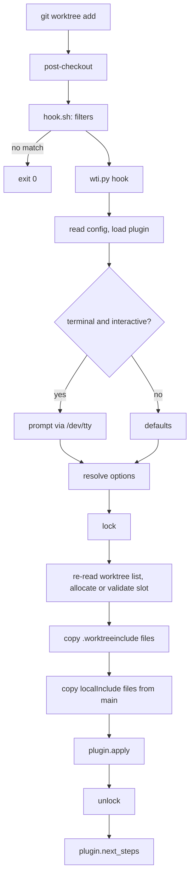

# Architecture

## Flow

`git wt add` sets `WT_*` variables and calls `git worktree add`, so it takes the same path. `git wt refresh` calls the same engine in `refresh` mode.

## Shim filters

`hook.sh` is registered globally, so it runs on every checkout of every repository. It exits early, in this order:

1. The previous HEAD is not all zeros, so this is not a fresh checkout.
2. The checkout is not a branch checkout.
3. `--git-dir` equals `--git-common-dir`, so this is not a linked worktree.
4. The worktree path matches an `ignorePaths` pattern.
5. Neither `worktree-init.plugin` nor `worktree-init.localInclude` is set, and the main worktree has no `.worktreeinclude`.

An ordinary checkout or clone costs at most two `git rev-parse`. Only a new linked worktree adds another `rev-parse`, up to four `git config` and one `git worktree list`. Python starts only after all filters passed.

## `wti.py` instead of `python -m`

The hook runs `python3 <clone>/wti.py`, not `python -m git_worktree_init`. With `-m`, the working directory is on `sys.path`, and the hook runs inside the repository of the caller, which could shadow a module of the standard library or of this package. A script path puts only the directory of the script on `sys.path`. `wti.py` also checks the Python version before importing anything else.

## Lock and slot allocation

Two worktrees created at the same time could otherwise pick the same free slot. Choosing a slot and writing it through the plugin therefore happen under one exclusive `flock` on `<common dir>/worktree-init.lock`. The worktree list is read again after the lock is taken, because the list read before the prompt may be stale. The prompt itself runs outside the lock, so a waiting user does not block others. Its recommended slot is only a default and is validated again under the lock.

## Source is the main worktree

`post-checkout` runs inside the new worktree. Nothing tells the hook which worktree `git worktree add` was called from, so the default source is the main worktree. `--source .` or `WT_SOURCE=$PWD` overrides this. The path must be absolute, because it is resolved inside the hook and not relative to the caller.

## Local includes ignore the source

`worktree-init.localInclude` names private files such as personal agent instructions. They are copied once and then diverge on purpose, so the copy in another worktree is not a reliable origin. The main worktree is, so these files always come from there, and an existing file is never overwritten. The list lives in the local config because naming these files in a tracked `.worktreeinclude` would publish them.

## `git -c` switches prompts off

`git -c worktree-init.slot=3 worktree add` reaches the hook as `GIT_CONFIG_PARAMETERS`. The engine reads config with `--show-scope`, sees the scope `command` and treats the option as given explicitly. Asking for an option that was just set on the command line would be wrong, so an option set this way, or through `WT_<NAME>`, disables the prompts.

## Sanitized Git environment

`GIT_DIR`, `GIT_WORK_TREE`, `GIT_INDEX_FILE` and `GIT_PREFIX` are removed for every Git call and every plugin subprocess. Git exports them to hooks, and they would pin each nested command to the repository and index of the caller instead of the directory it runs in. A plugin can name more variables in `SANITIZE_ENV`.

## Messages go to stderr

Git redirects the stdout of a hook to stderr. The core writes everything to stderr from the start, so output looks the same in the hook and in `git wt`. Only `-h` of `git wt` writes to stdout, because it is output rather than a message.

## `/dev/tty` with two handles

The prompt reads and writes the terminal, not stdin and stdout, which Git may have redirected. `/dev/tty` is opened twice, once for reading and once for writing. A single handle in `r+` mode is not seekable on a terminal, and Python's buffered text layer fails on it.

## Harness

The harness is a second repository for files that must not reach the code remote, such as agent instructions, plans and handoffs. It is a bare repository at `<git-common-dir>/harness.git`, so every worktree finds it no matter where it lives.

The main worktree uses `HEAD` and index of `harness.git` itself. Each linked code worktree gets its own linked-worktree admin directory `harness.git/worktrees/<name>`, named like the admin directory of the code worktree and written by hand rather than by `git worktree add`. Harness commands run as `git --git-dir=<admin directory> --work-tree=<worktree>`. A linked worktree named `main` therefore cannot collide with the main worktree. The admin directory holds `HEAD`, `index`, `commondir` and `gitdir`, so every worktree has its own harness branch and index while refs and objects are shared. The worktree root keeps only the `.git` file of the code repository.

`gitdir` does not point to `<worktree>/.git`. It points to an anchor file `<git-common-dir>/worktrees/<name>/harness-anchor` inside the Git directory of the code worktree. Pointing at `<worktree>/.git` would let `git worktree repair` in the harness rewrite the `.git` file of the code worktree. With the anchor, the lifecycle follows the code repository. `git worktree prune` in the harness keeps an admin directory as long as its code worktree exists, and drops it once `git worktree remove` deleted the code admin directory. Because Git knows these admin directories, `git gc` in the harness keeps objects referenced only by a worktree index.

Two alternatives were tried and rejected:

- `extensions.worktreeConfig` with `core.worktree` per admin directory saves the explicit `--work-tree`, but requires `core.bare=false` in the shared config. The tool passes `--work-tree` anyway.
- A separate Git directory per worktree with `objects/info/alternates` keeps branches apart, so every branch would have to be fetched and pushed between them. `git gc` in the shared repository may delete objects the others still need, and nothing removes the directory with the worktree.

`harness.git/config` sets `core.excludesFile=/dev/null`, because a global excludes file may ignore the harness paths, and disables the global hooks for harness operations. The allowlist lives in `harness.git/info/exclude`. A tracked `.gitignore` of the code repository still applies and has precedence over `info/exclude`. Snapshots therefore list new files with `git ls-files --others --exclude-from=harness.git/info/exclude`, which skips the standard ignore files, and add them with `--force`.

Submitted features are detected through the `reference-transaction` hook. A fetch, and the fetch inside `git pull --rebase`, updates `refs/remotes/origin/develop` in one transaction and calls the hook with the states `preparing`, `prepared` and `committed`. The hook acts only on `committed` and only when that ref is among the updated ones. It fires for every ref update, so the shim filters on stdin without starting a process.

`harness-hook.sh` is registered globally like `hook.sh` and exits before Python when `GIT_DIR` points into a `harness.git`, when the repository has no `harness.git`, or when the number of arguments matches no handled event. Git passes no event name to a hook from the config, so the shim derives it from the arguments: three for `post-checkout`, two for `pre-push`, one for `reference-transaction`. One registration then serves all events, and one override `hook.harness.enabled=false` in `harness.git/config` keeps harness operations from triggering it. The shim always exits with 0, even if Python fails to start. A non-zero exit would stop a `git push`, and in the state `prepared` it would abort the ref update of a `reference-transaction`.

A new worktree has no harness index yet. Its first checkout is forced and skips the snapshot, because comparing an empty index with `develop` would commit the deletion of every harness file. A checkout of the branch the harness already follows is skipped as well.

An admin directory whose anchor no longer exists belongs to a removed code worktree. It is deleted before a new one is created under the same name, and `git worktree prune` in the harness drops the others. Otherwise a reused worktree name would inherit the old index and snapshot the deletion of every harness file onto the old branch, and a branch of a removed worktree could not be checked out again. `prune` is safe here because of the anchor.

Never run `git worktree remove` or `move` against `harness.git`. `remove` and `move` would act on the path in `gitdir`, which is the Git directory of the code worktree.

## Limits

- The hook itself has no flags. `git wt add` provides them.
- The calling worktree cannot be detected, so the source is the main worktree unless given.
- Prompts need a terminal.
- The registration is global. The cost of the shim is described under "Shim filters".
- All messages go to stderr.
- `/dev/tty` is opened twice, once for reading and once for writing, because a single `r+` handle is not seekable on a terminal.
