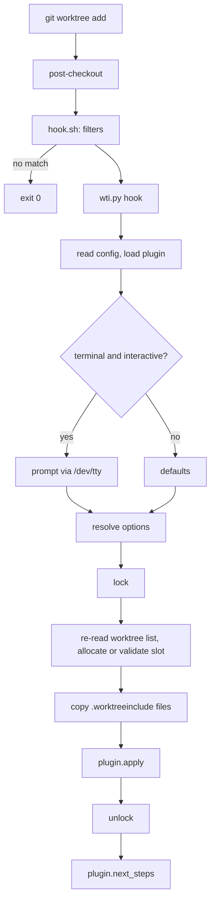

# Architecture

## Flow

`git wt add` sets `WT_*` variables and calls `git worktree add`, so it takes the same path. `git wt refresh` calls the same engine in `refresh` mode.

## Shim filters

`hook.sh` is registered globally, so it runs on every checkout of every repository. It exits early, in this order:

1. The previous HEAD is not all zeros, so this is not a fresh checkout.
2. The checkout is not a branch checkout.
3. `--git-dir` equals `--git-common-dir`, so this is not a linked worktree.
4. The worktree path matches an `ignorePaths` pattern.
5. Neither `worktree-init.plugin` is set nor the main worktree has a `.worktreeinclude`.

An ordinary checkout or clone costs at most two `git rev-parse`. Only a new linked worktree adds another `rev-parse`, up to two `git config` and one `git worktree list`. Python starts only after all filters passed.

## `wti.py` instead of `python -m`

The hook runs `python3 <clone>/wti.py`, not `python -m git_worktree_init`. With `-m`, the working directory is on `sys.path`, and the hook runs inside the repository of the caller, which could shadow a module of the standard library or of this package. A script path puts only the directory of the script on `sys.path`. `wti.py` also checks the Python version before importing anything else.

## Lock and slot allocation

Two worktrees created at the same time could otherwise pick the same free slot. Choosing a slot and writing it through the plugin therefore happen under one exclusive `flock` on `<common dir>/worktree-init.lock`. The worktree list is read again after the lock is taken, because the list read before the prompt may be stale. The prompt itself runs outside the lock, so a waiting user does not block others. Its recommended slot is only a default and is validated again under the lock.

## Source is the main worktree

`post-checkout` runs inside the new worktree. Nothing tells the hook which worktree `git worktree add` was called from, so the default source is the main worktree. `--source .` or `WT_SOURCE=$PWD` overrides this. The path must be absolute, because it is resolved inside the hook and not relative to the caller.

## `git -c` switches prompts off

`git -c worktree-init.slot=3 worktree add` reaches the hook as `GIT_CONFIG_PARAMETERS`. The engine reads config with `--show-scope`, sees the scope `command` and treats the option as given explicitly. Asking for an option that was just set on the command line would be wrong, so an option set this way, or through `WT_<NAME>`, disables the prompts.

## Sanitized Git environment

`GIT_DIR`, `GIT_WORK_TREE`, `GIT_INDEX_FILE` and `GIT_PREFIX` are removed for every Git call and every plugin subprocess. Git exports them to hooks, and they would pin each nested command to the repository and index of the caller instead of the directory it runs in. A plugin can name more variables in `SANITIZE_ENV`.

## Messages go to stderr

Git redirects the stdout of a hook to stderr. The core writes everything to stderr from the start, so output looks the same in the hook and in `git wt`. Only `--help` of `git wt` writes to stdout, because it is output rather than a message.

## `/dev/tty` with two handles

The prompt reads and writes the terminal, not stdin and stdout, which Git may have redirected. `/dev/tty` is opened twice, once for reading and once for writing. A single handle in `r+` mode is not seekable on a terminal, and Python's buffered text layer fails on it.

## Limits

- The hook itself has no flags. `git wt add` provides them.
- The calling worktree cannot be detected, so the source is the main worktree unless given.
- Prompts need a terminal.
- The registration is global. For an ordinary checkout or clone the shim costs at most two `git rev-parse`.
